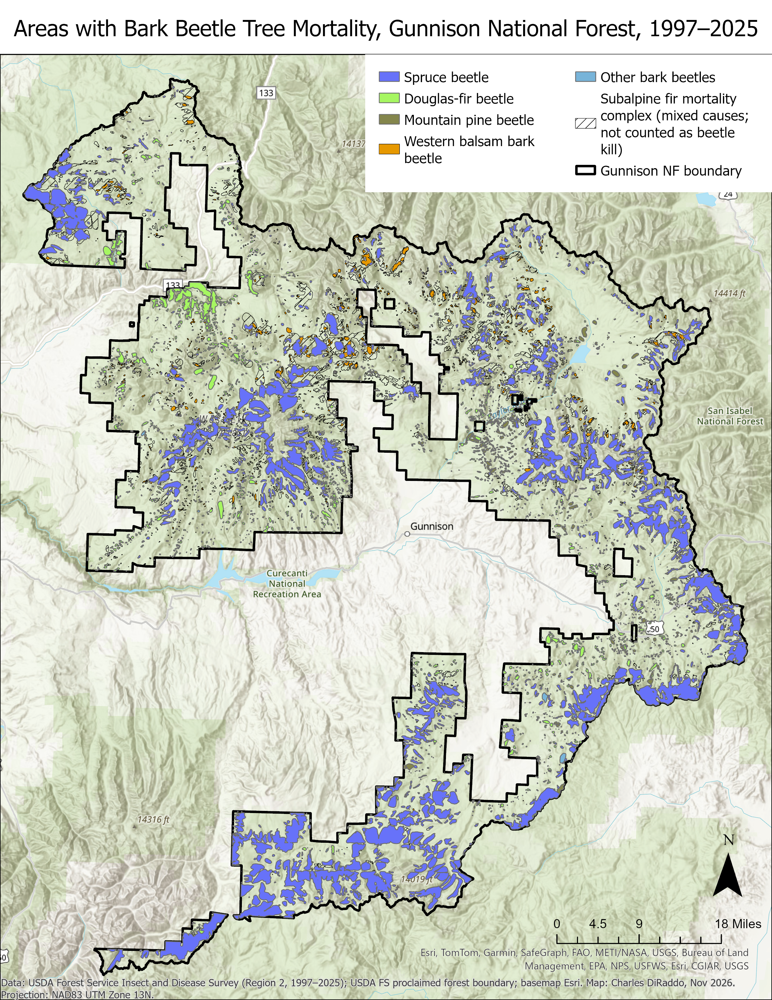

# Bark Beetle Tree Mortality, Gunnison National Forest, 1997–2025
 
I spent the 2026 season as a wilderness ranger in the Gunnison National Forest, where I learned about beetle kill from what I saw on the trail and from Forest Service coworkers. This project asks which bark beetles killed trees in the Gunnison and how many acres each one affected.
 

 
## Result
 
| Beetle | Acres (approx.) |
|---|---:|
| Spruce beetle | 246,817 |
| Douglas-fir beetle | 34,777 |
| Western balsam bark beetle | 23,501 |
| Mountain pine beetle | 10,814 |
| Other bark beetles | 1,150 |
| *Subalpine fir mortality complex (see note)* | *150,131* |
 
Each acre is counted once per beetle. Beetles' areas can overlap, so the rows shouldn't be added together.

Note on Subalpine fir mortality complex: I included Subalpine fir mortality complex because of the significant role Western balsam bark beetle plays in it (Lalande et al., 2020). However, other factors also contribute, such as fungal disease, climate change, and stand density. The survey data begins counting the Western balsam bark beetle as it's own damage cause in 2015, which is reflected in the results. 
 
## Data
 
- [USDA Forest Service Insect and Disease Survey, Region 2](https://www.fs.usda.gov/foresthealth/docs/IDS_Data_for_Download/CONUS_Region2_AllYears.gdb.zip)
- [USDA Forest Service national forest boundaries](https://data.fs.usda.gov/geodata/edw/edw_resources/fc/BdyDesg_LSRS_ProclaimedForest.gdb.zip)
## Method (ArcGIS Pro)
 
1. Clipped the survey data to the Gunnison boundary and converted to an equal-area projection (EPSG:5070).
2. Kept only records where trees had a damage type of mortality and a damage cause of bark beetles (or Subalpine fir mortality complex). This resulted in about 16k polygons.
3. To make sure not to double count areas that were remapped year by year, I dissolved the polygons by beetle type (11 total).
4. Added a field to calculate the total area for each beetle, as shown in the results.
5. For the map display I used UTM Zone 13N, so north is straight up.

## Limitations
 
- Some areas are sketched from airplanes, so edges are approximate.
- An affected area has dead trees, but not necessarily all of the trees in the area are dead. Since 2015 the survey records the percent of trees affected in each area. This project doesn't use it because earlier years don't have it. Ranges can be from 1% to over 50%.

## References
 
- Lalande, B. M., Hughes, K., Jacobi, W. R., Tinkham, W. T., Reich, R., & Stewart, J. E. (2020). Subalpine fir mortality in Colorado is associated with stand density, warming climates and interactions among fungal diseases and the western balsam bark beetle. *Forest Ecology and Management*, 466, 118133. https://doi.org/10.1016/j.foreco.2020.118133
## Files
 
 - `exports/` has the map
- `data/processed/` has the GeoPackage and CSV tables
- `data/metadata/` has the FGDC and ISO metadata
## License
 
[CC BY 4.0](LICENSE)
 

